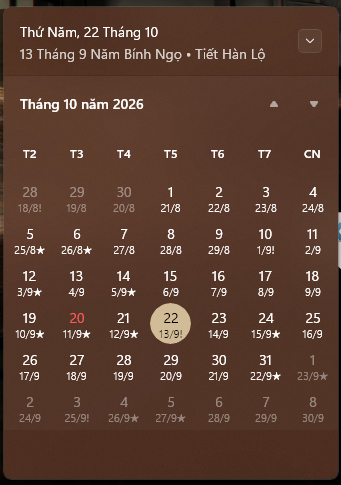
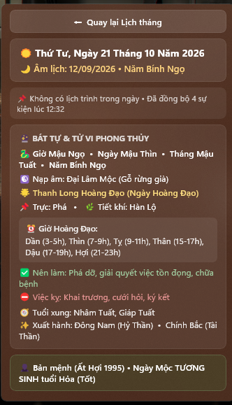
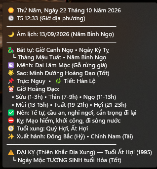
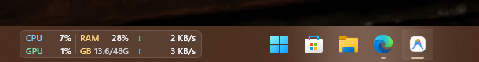
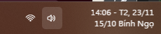
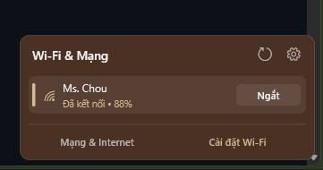
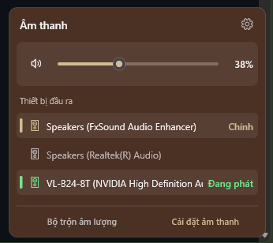

# 🌕 Lịch Vạn Niên, Tử Vi Phong Thủy & Tiện Ích Taskbar Đa Màn Hình

-0078D6)

Bản Mod dành cho **Windhawk** (hỗ trợ đầy đủ **Windows 11** và **Windows 10**) giúp biến thanh Taskbar và khay Lịch (Calendar Flyout) mặc định của Windows thành một **Lịch Vạn Niên Việt Nam** hoàn chỉnh, kết hợp **Đồng bộ lịch trình Google Calendar (.ics)**, **Tử Vi - Phong Thủy cá nhân hóa theo năm sinh**, **Khung theo dõi thông số hệ thống trực tiếp trên Taskbar (CPU, GPU, RAM, Mạng, Ping)** và **Cụm điều khiển Wi-Fi & Âm thanh độc lập cho màn hình phụ**.

---

## 📸 Hình ảnh thực tế

### 1. Lịch Vạn Niên, Tooltip Phong Thủy & Bảng Tử Vi (Fluent Card UI)

| Khay Lịch tháng Âm lịch | Bảng Chi tiết Bát Tự & Tử Vi | Hộp chú thích (Tooltip) |
| :---: | :---: | :---: |
|  |  |  |

### 2. Khung Thông số hệ thống trực tiếp trên Taskbar (CPU, GPU, RAM, Mạng, Ping)

### 3. Tiện ích Đa Màn Hình: Cụm Wi-Fi & Âm thanh độc lập trên Màn hình phụ (Fluent UI 120fps)

| 2 nút Wi-Fi & Âm thanh trên Taskbar phụ | Bảng điều khiển Wi-Fi & Mạng | Bảng điều khiển Âm thanh (hỗ trợ FxSound) |
| :---: | :---: | :---: |
|  |  |  |

---

## ✨ Tính năng nổi bật

### 🗓️ Lịch Vạn Niên, Tử Vi & Google Calendar
* **Đồng hồ Taskbar 2 dòng / 1 dòng:** Hiển thị song song Dương lịch và Âm lịch Can Chi (tự động tính tháng Nhuận, chuẩn múi giờ UTC+7).
* **Khay Lịch tháng thông minh (Calendar Flyout):**
  * Đánh dấu ngôi sao **(★)** cho ngày Hợp tuổi (*Tam Hợp, Lục Hợp, Tương Sinh*) và dấu **(!)** cho ngày Xung tuổi (*Lục Xung, Thiên Khắc Địa Xung*).
  * Đánh dấu chấm tròn **(•)** cạnh ngày Dương lịch có sự kiện Google Calendar (ví dụ: `25•`).
  * Tự động tô đỏ các ngày Lễ, Tết truyền thống Việt Nam.
* **Bảng Chi tiết Tử Vi & Ghi chú (Fluent Card UI):** Bấm vào bất kỳ ngày nào trên lịch để xem chi tiết lịch trình Google Calendar, Bát tự, Ngũ hành Nạp âm, Sao Hoàng/Hắc Đạo, 12 Trực, 24 Tiết khí, Giờ Hoàng Đạo và hướng xuất hành (Hỷ Thần / Tài Thần).
* **Bảo mật riêng tư trên Tooltip:** Cho phép ẩn nội dung ghi chú Google Calendar nhạy cảm khi vô tình rê chuột qua đồng hồ Taskbar.

### 📊 Khung theo dõi Thông số hệ thống trên Taskbar
* Hiển thị thời gian thực **`% CPU`**, **`% GPU`**, **`% & GB RAM`**, **tốc độ Mạng (`↓ Tải xuống / ↑ Tải lên`)** và **độ trễ `Ping (ms)`**.
* **Kéo thả tự do & Ghi nhớ vị trí vĩnh viễn:** Giữ chuột trái kéo tới vị trí phù hợp trên Taskbar; tọa độ được lưu cố định vào `HKCU\Software\VnLunarAlmanac\Settings`, giữ nguyên sau khi khởi động lại máy.
* **Thao tác nhanh:** Nhấp đúp mở **Task Manager**; nhấp chuột phải để bật/tắt nhanh từng chỉ số hoặc chọn **"Đặt lại vị trí"**.
* Tương thích mượt mà với chế độ **Ẩn Taskbar (Auto-Hide)**, giữ nguyên hiển thị khi mở **Start Menu**, và tự ẩn đúng từng màn hình khi có ứng dụng/game chạy **Fullscreen**.

### 🖥️ Tiện ích Đa Màn Hình (Multi-Monitor)
* **Tự động nhận diện tất cả màn hình thứ 2 trở lên** (bỏ qua màn hình chính để tránh trùng lặp), hoạt động **độc lập 100%** — không làm bật hay ảnh hưởng Taskbar màn hình chính.
* **2 nút tách biệt (Wi-Fi / Mạng và Âm thanh) kèm bảng điều khiển nổi Fluent UI 120fps:**
  * **Wi-Fi & Mạng:** Hiển thị danh sách mạng Wi-Fi khả dụng cùng cường độ sóng, bấm **Kết nối / Ngắt kết nối** trực tiếp (mạng đã lưu hồ sơ), nút **Quét lại (`↻`)**, hiển thị chính xác **Ethernet vật lý thật** (tự động lọc bỏ card mạng ảo Hyper-V, WSL, VPN).
  * **Âm thanh:** Thanh trượt âm lượng mượt 120fps, nút **Tắt/Bật tiếng (Mute)** tức thì, **lăn con lăn chuột trực tiếp trên icon Loa** để tăng/giảm ±2% kèm OSD `%`, hỗ trợ **chuyển đổi thiết bị đầu ra** (Loa / Tai nghe / Màn hình) ngay trên màn hình phụ.
  * **Tích hợp thông minh với FxSound:** Khi `FxSound` đang chạy và bật làm đầu ra mặc định, bấm chọn loa vật lý sẽ tự động chuyển loa phát qua FxSound mà vẫn giữ **FxSound** làm đầu ra chính (hiển thị nhãn **`Chính`** và **`Đang phát`** trực quan).
* **Đồng bộ màu & co giãn thông minh:**
  * Nền 2 bảng nổi tự động lấy theo đúng màu thực tế của thanh Taskbar (Dark / Light / Accent Color / Mica).
  * Tự động trượt ngang co giãn mượt mà khi có biểu tượng chuông thông báo / Do Not Disturb (`🔔zZ`) xuất hiện bên cạnh đồng hồ, không bị đè chữ.
  * Khóa cố định vị trí 2 bảng nổi ngay lúc mở, đứng yên vững chắc khi bật chế độ **Ẩn Taskbar (Auto-Hide)**.
* **Nhân bản Khung Thông số lên màn hình phụ:** Tùy chọn hiển thị thêm khung đo CPU / GPU / RAM / Mạng / Ping trên màn hình phụ, hỗ trợ kéo thả và ghi nhớ vị trí độc lập với màn hình chính.

---

## ⚙️ Danh sách các tùy chỉnh (Settings) trong Mod

| Nhóm | Tùy chọn | Mô tả |
| :--- | :--- | :--- |
| **Ngôn ngữ & Tử Vi** | `language` | Ngôn ngữ hiển thị (`Tự động`, `Tiếng Việt`, `English`) |
| | `birthYear` | Năm sinh Âm lịch (VD: `1995`, `2000`) để tính Ngũ hành & ngày Hợp `(★)` / Xung `(!)` |
| | `markPersonalDaysOnCalendar` | Bật/tắt đánh dấu ngày Hợp / Xung trên lưới lịch |
| **Google Calendar** | `googleIcsUrl` | Dán 1 hoặc nhiều link `.ics` (cách nhau bằng dấu `;`) |
| | `icsRefreshMinutes` | Chu kỳ tự động đồng bộ lịch ngầm (mặc định `10` phút) |
| | `markGoogleEventsOnCalendar` | Gắn dấu chấm `(•)` trên ô ngày có sự kiện |
| | `showGoogleEventsInTooltip` | Bật/tắt hiển thị nội dung ghi chú trên Tooltip (bảo mật riêng tư) |
| | `tooltipOpacity` *(Win 10)* | Độ trong suốt nền Tooltip Acrylic (`80`–`240`) |
| **Đồng hồ & Khay Lịch** | `enableTaskbarClock` | Bật/tắt hiển thị Âm lịch trên Taskbar |
| | `taskbarClockSolarOnTop` | Định dạng 2 dòng (Dương trên / Âm dưới) hoặc 1 dòng |
| | `enableTaskbarTooltip` | Bật/tắt hộp Tooltip Tử Vi & Ghi chú khi rê chuột vào đồng hồ |
| | `enableCalendarFlyout` | Bật/tắt Âm lịch & ngày lễ đỏ trong khay Lịch |
| | `enableHoroscopePage` | Mở bảng chi tiết Tử Vi & Ghi chú khi bấm vào từng ngày trên lịch |
| **Thông số & Đa màn hình** | `enableTaskbarSystemStats` | Bật/tắt khung thông số hệ thống trên Taskbar màn hình chính |
| | `enableSecondaryMonitorTray` | Bật/tắt 2 nút **Wi-Fi & Âm thanh** độc lập trên các màn hình phụ |
| | `enableSecondaryMonitorStats` | Bật/tắt khung thông số hệ thống nhân bản trên các màn hình phụ |
| | `showCpuStats` / `showGpuStats` / `showRamStats` / `showNetStats` / `showPingStats` | Bật/tắt chi tiết từng chỉ số `% CPU`, `% GPU`, `RAM`, tốc độ Mạng (`↓/↑`) và `Ping (ms)` |

---

## 🚀 Cách cài đặt vào Windhawk

1. Tải và cài đặt phần mềm [Windhawk](https://windhawk.net/).
2. Mở Windhawk, bấm nút **Create a new mod** (Tạo mod mới) ở góc dưới bên phải.
3. Chọn đúng tệp mã nguồn tương ứng với hệ điều hành của bạn ở thư mục gốc của kho mã nguồn:
   * 💻 **Windows 11:** [`vn-lunar-almanac-horoscope-win11.wh.cpp`](./vn-lunar-almanac-horoscope-win11.wh.cpp)
   * 🖥️ **Windows 10:** [`vn-lunar-almanac-horoscope-win10.wh.cpp`](./vn-lunar-almanac-horoscope-win10.wh.cpp)
4. Sao chép toàn bộ nội dung tệp và dán đè vào trình soạn thảo mã nguồn của Windhawk, sau đó nhấn **Compile Mod** (Biên dịch).
5. Chuyển sang tab **Settings** (Cài đặt) để bật/tắt các tiện ích mong muốn, nhập Năm sinh Âm lịch và dán link `.ics` Google Calendar của bạn.

---

## 📅 Hướng dẫn lấy link đồng bộ Google Calendar (.ics)

1. Mở **Google Calendar** trên trình duyệt máy tính → nhấn biểu tượng **Cài đặt (⚙️ Settings)** ở góc trên bên phải → chọn **Cài đặt (Settings)**.
2. Ở cột menu bên trái, chọn **Tên lịch cá nhân của bạn** dưới mục *Cài đặt cho lịch của tôi (Settings for my calendars)*.
3. Cuộn xuống gần cuối trang, tìm mục **Địa chỉ bí mật ở định dạng iCal (Secret address in iCal format)**.
4. Sao chép đường link có dạng `https://calendar.google.com/calendar/ical/.../basic.ics` và dán vào ô **Link Google Calendar cá nhân (.ics)** trong tab **Cài đặt** của Mod.
